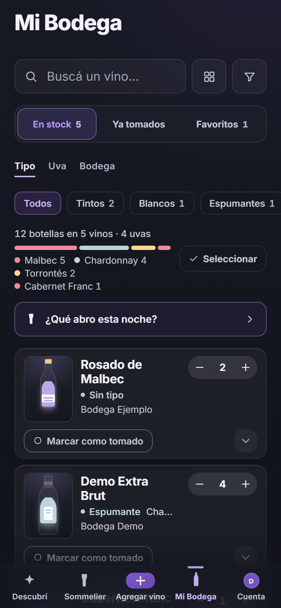
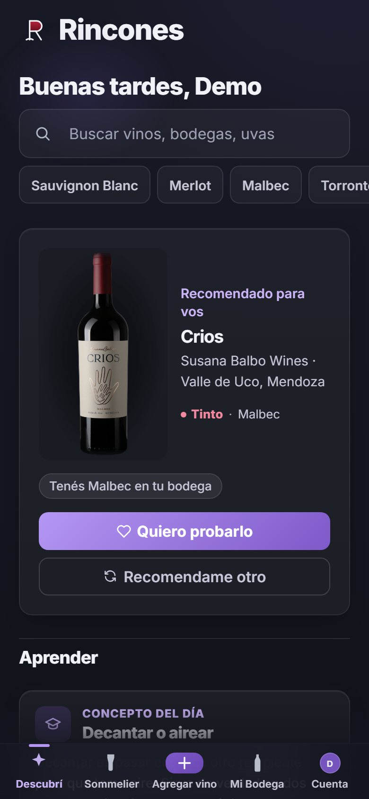

**Español** | [English](README.md)

# Rincones

[](https://github.com/benjaespina98/rincones/actions/workflows/ci.yml)
[](LICENSE)


Una bodega personal de vinos con sommelier de IA. Lleva el registro de lo que tenés, lo que tomaste y lo que querés probar, y responde qué abrir esta noche. La interfaz está en español rioplatense.

**App en producción:** https://rincones.vercel.app (con usuarios reales)

<p>
  
  
</p>

## Funcionalidades

- **Chat con sommelier de IA.** Preguntás qué abrir o qué maridar con un plato. La respuesta se escribe en vivo y las conversaciones quedan guardadas.
- **Escáner de etiquetas.** Sacás una foto y Gemini Vision completa el vino. Si la IA no está disponible, usa OCR local (Tesseract.js).
- **Mi Bodega.** Stock por lote de compra, con marcas independientes de "tomado" y "favorito", filtros y acciones en lote.
- **Descubrí.** Recomendaciones según lo que ya tenés en la bodega y un concepto de vino por día.
- **Quiero probar.** Una lista de deseos separada del stock real, con un paso para pasar el vino a la bodega.
- **Momentos y valoraciones.** Un diario de cada botella que abrís, más puntajes y reseñas de la comunidad.
- **Cuentas.** Ingreso con email y contraseña o con Google, verificación de email, exportación de datos y baja de la cuenta.
- **PWA instalable y panel de administración.** Service worker y manifest, y un área de administración con métricas de uso, campañas, usuarios y moderación de reseñas.

## Stack

- **Frontend:** React 19, Vite 7, React Router 7, Axios, CSS plano.
- **Backend:** Node.js 22, Express 5, sesiones con JWT (cookie de refresh httpOnly), Helmet, límites de tasa.
- **Datos y servicios:** MongoDB (Atlas) con Mongoose 9, Google Gemini, Cloudinary.
- **Testing:** Vitest 4 y Testing Library, test runner de Node, Playwright (punta a punta).
- **Deploy:** Vercel (dos proyectos: client y API), GitHub Actions para CI.

## Correrlo en local

Necesitás Node.js 22 y una instancia de MongoDB (local o Atlas).

```bash
git clone https://github.com/benjaespina98/rincones.git
cd rincones
npm install
cp server/.env.example server/.env
cp client/.env.example client/.env
npm run dev
```

La app corre en http://localhost:5173 y la API en http://localhost:4000/api.

| Variable | Dónde | Obligatoria | Para qué |
|---|---|---|---|
| `MONGODB_URI` | server | Sí | Cadena de conexión a MongoDB |
| `MONGODB_DB_NAME` | server | Sí | Nombre de la base (`test` para trabajar en local) |
| `JWT_SECRET` | server | Sí | Firma de los tokens de sesión |
| `FRONTEND_URL` | server | Sí | Origen del cliente (CORS y enlaces de mails) |
| `GEMINI_API_KEY` | server | No | Funciones de IA. Sin ella, el escaneo usa OCR |
| `VITE_API_URL` | client | Sí | URL base de la API |

Cada variable está explicada en `server/.env.example` y `client/.env.example`. La lista completa está en [docs/environment.md](docs/environment.md).

## Tests

```bash
npm test -w server     # test runner de Node
npm test -w client     # Vitest
npm run e2e -w client  # Playwright, contra una base de prueba local
```

Cerca de 1.700 tests unitarios y de integración cubren lotes de stock, sesiones, autenticación en cada ruta, respaldos de la IA y la interfaz. La CI corre lint, tests, build y un chequeo de tamaño del bundle.

## Estructura del proyecto

```
client/   App React (Vite), con tests unitarios y specs e2e
server/   API Express, modelos de Mongoose, scripts
docs/     Documentación extendida y capturas
.github/  Workflow de CI
```

## Más documentación

- [Arquitectura y decisiones técnicas](docs/architecture.md)
- [Referencia de la API](docs/api.md)
- [Variables de entorno](docs/environment.md)
- [Despliegue y dominio propio](docs/deployment.md)
- [Backups, migraciones y monitoreo](docs/operations.md)

## Autor

**Benjamín Espina**

- [LinkedIn](https://linkedin.com/in/benjamin-espina)
- [GitHub](https://github.com/benjaespina98)
- [Portfolio](https://benjaminespina.com)

## Licencia

[ISC](LICENSE)
