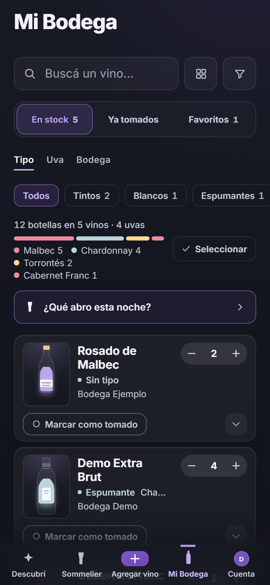
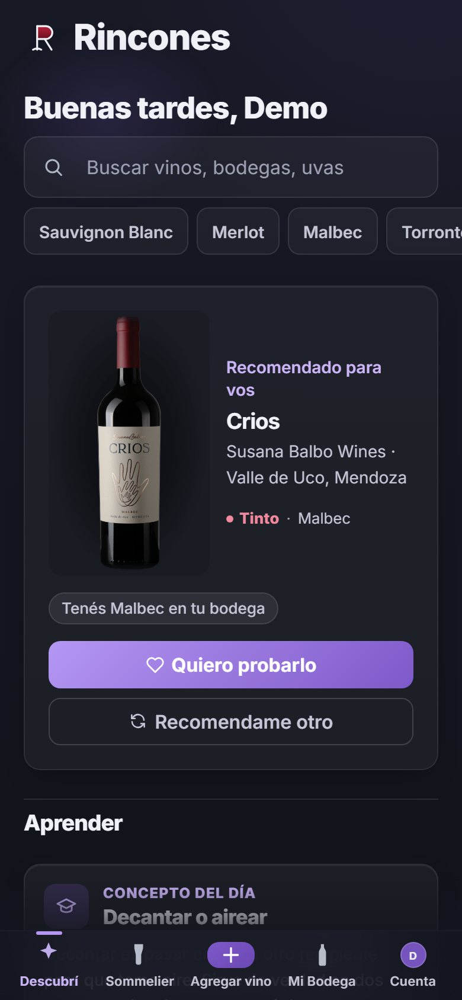

[Español](README.es.md) | **English**

# Rincones

[](https://github.com/benjaespina98/rincones/actions/workflows/ci.yml)
[](LICENSE)


A personal wine cellar app with an AI sommelier. It tracks what you own, what you drank and what you want to try, and it answers what to open tonight. The interface is in Spanish (Argentina).

**Live app:** https://rincones.vercel.app (in production, with real users)

<p>
  
  
</p>

## Features

- **AI sommelier chat.** Ask what to open or what to pair with a dish. Answers stream in, and conversations are saved.
- **Label scanner.** Take a photo and Gemini Vision fills in the wine. If the AI is unavailable, it falls back to local OCR (Tesseract.js).
- **My cellar.** Stock by purchase batch, plus independent "drank" and "favorite" flags, with filters and bulk actions.
- **Discover.** Recommendations based on what is already in your cellar, and a daily wine concept.
- **Want to try.** A wishlist kept apart from real stock, with one step to move a wine into the cellar.
- **Moments and ratings.** A diary of each bottle you open, plus ratings and community reviews.
- **Accounts.** Email and password or Google sign-in, email verification, data export and account deletion.
- **Installable PWA and admin panel.** Service worker and manifest, and an admin area for usage metrics, campaigns, users and review moderation.

## Stack

- **Frontend:** React 19, Vite 7, React Router 7, Axios, plain CSS.
- **Backend:** Node.js 22, Express 5, JWT sessions (httpOnly refresh cookie), Helmet, rate limiting.
- **Data and services:** MongoDB (Atlas) with Mongoose 9, Google Gemini, Cloudinary.
- **Testing:** Vitest 4 and Testing Library, Node test runner, Playwright (end to end).
- **Deploy:** Vercel (two projects: client and API), GitHub Actions for CI.

## Run it locally

You need Node.js 22 and a MongoDB instance (local or Atlas).

```bash
git clone https://github.com/benjaespina98/rincones.git
cd rincones
npm install
cp server/.env.example server/.env
cp client/.env.example client/.env
npm run dev
```

The app runs at http://localhost:5173 and the API at http://localhost:4000/api.

| Variable | Where | Required | Purpose |
|---|---|---|---|
| `MONGODB_URI` | server | Yes | MongoDB connection string |
| `MONGODB_DB_NAME` | server | Yes | Database name (`test` for local work) |
| `JWT_SECRET` | server | Yes | Signs session tokens |
| `FRONTEND_URL` | server | Yes | Client origin (CORS and email links) |
| `GEMINI_API_KEY` | server | No | AI features. Without it, scanning uses OCR |
| `VITE_API_URL` | client | Yes | API base URL |

Every variable is described in `server/.env.example` and `client/.env.example`. The full list is in [docs/environment.md](docs/environment.md).

## Tests

```bash
npm test -w server     # Node test runner
npm test -w client     # Vitest
npm run e2e -w client  # Playwright, against a local test database
```

About 1,700 unit and integration tests cover stock batches, sessions, auth guards on every route, AI fallbacks and the UI. CI runs lint, tests, build and a bundle size check.

## Project structure

```
client/   React app (Vite), with unit tests and e2e specs
server/   Express API, Mongoose models, scripts
docs/     Extended documentation and screenshots
.github/  CI workflow
```

## More documentation

- [Architecture and technical decisions](docs/architecture.md)
- [API reference](docs/api.md)
- [Environment variables](docs/environment.md)
- [Deployment and custom domain](docs/deployment.md)
- [Backups, migrations and monitoring](docs/operations.md)

The extended documentation is in Spanish.

## Author

**Benjamín Espina**

- [LinkedIn](https://linkedin.com/in/benjamin-espina)
- [GitHub](https://github.com/benjaespina98)
- [Portfolio](https://benjaminespina.com)

## License

[ISC](LICENSE)
